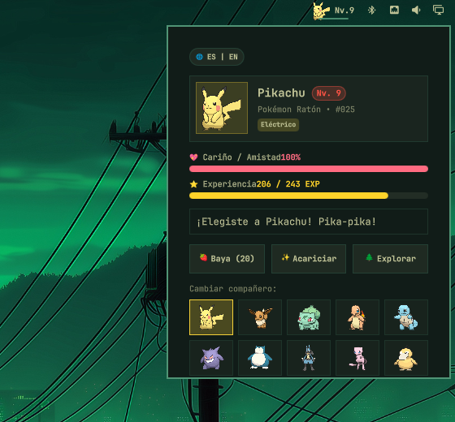

# 🎮 Pokémon Companion for Omarchy / para Omarchy

<p align="center">
  
</p>

<p align="center">
  <strong>An interactive animated Pokémon companion widget and popup panel for the Omarchy status bar.</strong><br/>
  <em>Un widget y panel emergente interactivo de Pokémon con animaciones pixel-art para la barra de estado de Omarchy.</em>
</p>

---

## 🌐 English

### ✨ Features
- **Animated Pixel-Art Bar Widget:** Shows your active Pokémon companion animating directly in your status bar along with its level (`Lv. 5`).
- **Care & Progression System:**
  - **💖 Friendship / Affection:** Bond with your Pokémon through care and attention.
  - **⭐ EXP & Levels:** Earn experience passively over system uptime and actively by caring for your companion.
  - **🍓 Feed Berries:** Feed Oran Berries to boost happiness and EXP. Berries replenish automatically over time.
  - **✨ Petting:** Tap to pet and show love to your Pokémon with custom animated reactions and sound-bites.
  - **🌲 Explore:** Encounter wild Pokémon wandering near your desktop.
  - **🔄 10 Iconic Companions:** Switch instantly between Pikachu, Eevee, Bulbasaur, Charmander, Squirtle, Gengar, Snorlax, Lucario, Mew, and Psyduck.
  - **🌐 Bilingual (ES / EN):** One-click toggle between English and Spanish.
- **Auto-Persistence:** Saves all stats, level, berries, and active companion in `~/.config/omarchy/pokemon-companion.json`.
- **Bar Shortcuts:**
  - **Left Click:** Open / Close companion panel.
  - **Right Click:** Quick pet (sends desktop notification).
  - **Middle Click:** Cycle to next companion.

### 🚀 Installation & Removal

#### Install
```bash
omarchy plugin add https://github.com/aletgdev/omarchy-pokemon-companion.git --enable
```

#### Move section
```bash
omarchy bar move aletgdev.pokemon-companion --section left
```

#### Disable
```bash
omarchy plugin disable aletgdev.pokemon-companion
```

#### Uninstall / Remove
```bash
omarchy plugin remove aletgdev.pokemon-companion

# Optional: remove saved progress
rm -f ~/.config/omarchy/pokemon-companion.json
```

---

## 🇪🇸 Español

### ✨ Características
- **Sprite interactivo en la barra:** Muestra a tu compañero Pokémon animado en pixel-art y su nivel actual (`Nv. 5`).
- **Sistema de cuidados y progreso:**
  - **💖 Cariño / Amistad:** Fortalece el vínculo con tu Pokémon cuidándolo.
  - **⭐ EXP y Niveles:** Gana experiencia de forma pasiva con el tiempo de encendido del sistema y activa al cuidarlo.
  - **🍓 Dar Bayas:** Aliméntalo con bayas Aranja para aumentar su cariño y EXP. Recibes bayas adicionales con el tiempo.
  - **✨ Acariciar:** Acaricia a tu Pokémon para ver reacciones felices y frases únicas.
  - **🌲 Explorar:** Descubre encuentros salvajes aleatorios en tu entorno.
  - **🔄 10 Compañeros Disponibles:** Cambia en cualquier momento entre Pikachu, Eevee, Bulbasaur, Charmander, Squirtle, Gengar, Snorlax, Lucario, Mew y Psyduck.
  - **🌐 Bilingüe (ES / EN):** Botón para alternar entre Español e Inglés al instante.
- **Persistencia automática:** Todo tu progreso se guarda en `~/.config/omarchy/pokemon-companion.json`.
- **Atajos en la barra:**
  - **Clic izquierdo:** Abrir / cerrar panel de cuidados.
  - **Clic derecho:** Acariciar rápido (notificación de escritorio).
  - **Clic central:** Cambiar al siguiente Pokémon.

### 🚀 Instalación y Desinstalación

#### Instalar
```bash
omarchy plugin add https://github.com/aletgdev/omarchy-pokemon-companion.git --enable
```

#### Mover de sección
```bash
omarchy bar move aletgdev.pokemon-companion --section left
```

#### Desactivar
```bash
omarchy plugin disable aletgdev.pokemon-companion
```

#### Desinstalar completamente
```bash
omarchy plugin remove aletgdev.pokemon-companion

# Opcional: borrar datos guardados
rm -f ~/.config/omarchy/pokemon-companion.json
```

---

## 📄 License
MIT License. Pokémon is a trademark of Nintendo, Creatures Inc., and GAME FREAK Inc. Sprites provided by PokeAPI.
